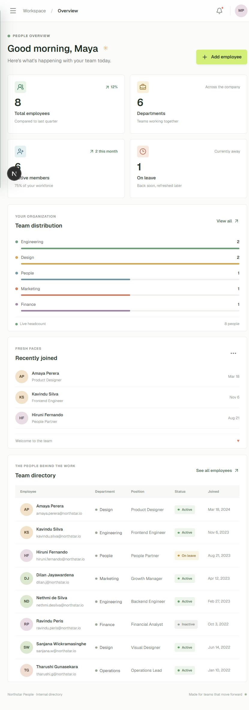
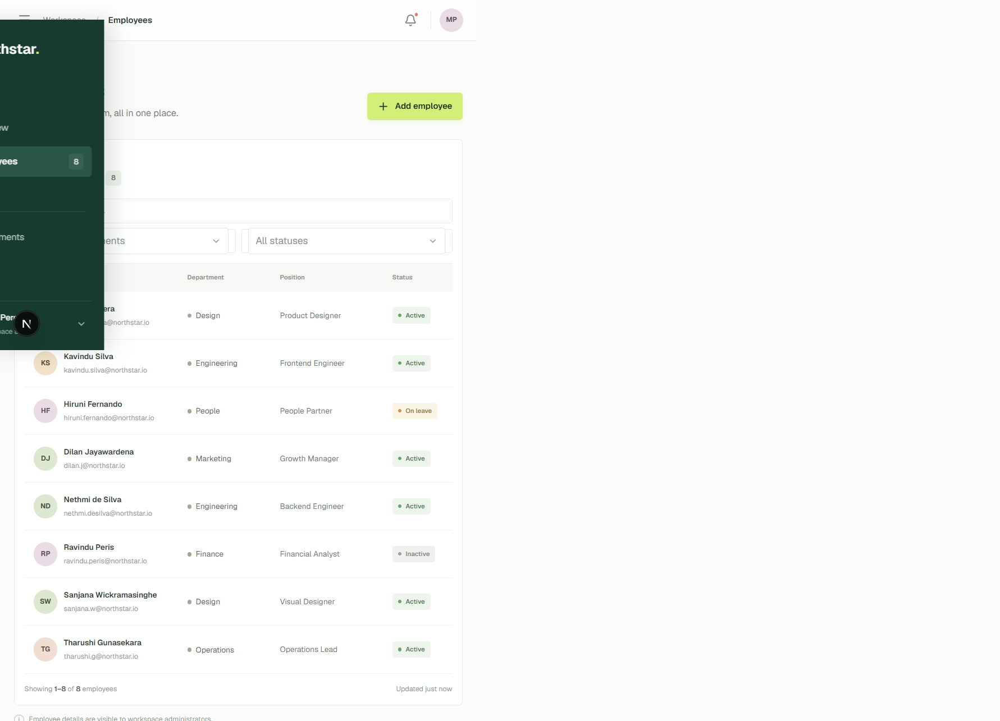

This is a [Next.js](https://nextjs.org) project bootstrapped with [`create-next-app`](https://nextjs.org/docs/app/api-reference/cli/create-next-app).

## Getting Started

First, run the development server:

```bash
# Northstar People

A responsive employee-management frontend built with Next.js App Router, TypeScript, Tailwind CSS, and Lucide icons.

## Run locally

```bash
npm install
npm run dev
```

Open [http://localhost:3000](http://localhost:3000). Without an API URL, the app starts with sample employees and saves changes in browser local storage.

## Connect the backend

Set `NEXT_PUBLIC_API_URL` in `.env.local` to the backend origin, for example:

```env
NEXT_PUBLIC_API_URL=http://localhost:4000
```

The frontend expects `GET /api/employees` to return an employee array or `{ "data": [...] }`. It uses `GET /api/employees/:id` for profiles and sends create, update, and delete requests to the matching routes. Updates use `PUT /api/employees/:id`.

Employee records contain `id`, `name`, `email`, `phone`, `department`, `position`, `status`, and `joinedAt`. Status values are `Active`, `On leave`, and `Inactive`.

## Checks

```bash
npm run lint
npm run build
```

## Screenshots




